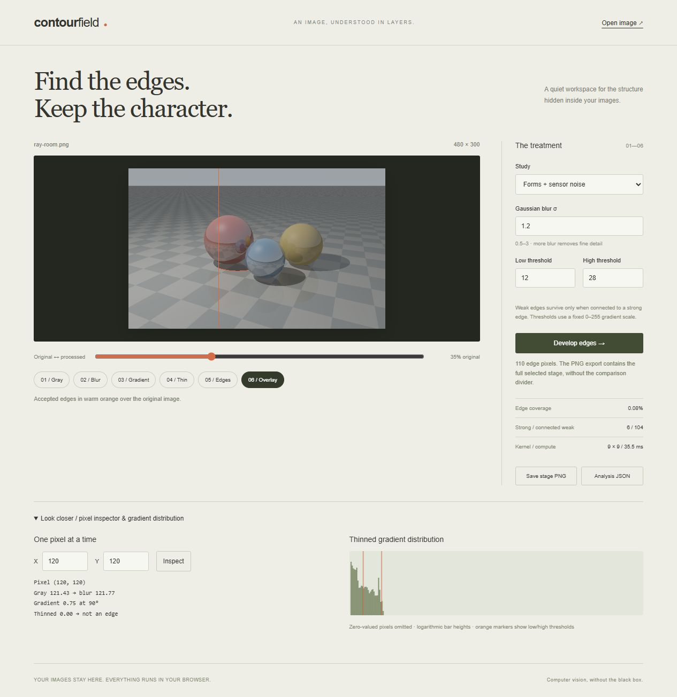

# Contour Field

A local computer-vision workbench that makes a Canny-style edge pipeline inspectable. Open an image, tune smoothing and thresholds, compare six processing stages, inspect a pixel, and export a complete stage as PNG.



## Run

Python 3.10+, no packages or build step:

```sh
python run.py
```

Open http://127.0.0.1:8000. All image decoding and processing happen in your browser. The loopback server exposes only five static assets, checks Host headers, and applies a restrictive content policy.

## Explore

- Start with geometric, noisy, or low-contrast samples, or load a PNG/JPEG/WebP up to 8 MB and 24 megapixels. Images are fitted inside 640×640 before processing, preserving aspect ratio; both output dimensions must be at least three pixels. Browser decoding and resizing may vary slightly across platforms.
- Adjust Gaussian sigma from 0.5 to 3 and low/high thresholds on the documented 0–255 gradient scale. Develop to apply changes; editing settings invalidates exports and shows the original until recomputed.
- Compare the original with grayscale, blur, gradient magnitude, thinned gradients, final edges, or an orange edge overlay. The divider is only for preview.
- Export the full selected stage as an opaque PNG, without the divider. The JSON report includes dimensions, parameters, counts, timing, histogram, and model conventions. It does not include the source image; retain the original to reproduce a run.
- Expand the pixel inspector for exact stage values and a nonzero, log-height gradient histogram. Strong and connected-weak counts explain how hysteresis changed the result.

## Pipeline

`core.js` implements every operation without an imaging dependency:

1. Composite transparency on white and use Rec.709 channel weights on display-referred RGB. This is not a linear-light colorimetric conversion.
2. Apply a normalized separable Gaussian with radius `ceil(3σ)` and clamped borders.
3. Compute 3×3 Sobel derivatives. Scale Euclidean magnitude by `1 / (4√2)` to stay within 0–255; thresholds use this fixed scale, not per-image normalization. A one-pixel image border is zeroed.
4. Quantize gradient directions into four bins and suppress nonmaxima. The comparison is `m >= previous && m > next`, selecting a deterministic side of equal plateaus.
5. Seed positive pixels at or above the high threshold, then flood through eight-connected positive pixels at or above the low threshold. Zero intensity never becomes an edge, including when thresholds are zero.

The method follows the stages described in [OpenCV's Canny tutorial](https://docs.opencv.org/4.12.0/da/d5c/tutorial_canny_detector.html). It is an independent educational implementation, not a bit-for-bit OpenCV clone: normalization, border behavior, quantized suppression, and plateau ties are explicit choices here. It does not provide semantic segmentation, object recognition, subpixel contours, or vector tracing.

The worker keeps computation off the UI thread. New edits terminate stale work, and revision tokens prevent late image decodes from overwriting newer choices. Processing is O(width × height × kernel radius), with bounded typed-array storage. Source pixels are retained separately from exported stages.

## Verification

Node.js 22+ is needed for development checks:

```sh
npm test
npm run check
python -m unittest discover -s tests -p "test_*.py"
```

13 JavaScript tests cover alpha compositing, kernel normalization, constant-field preservation, separable blur against an independent full 2D convolution, known Sobel ramps, deterministic plateau suppression, connected weak chains, zero thresholds, exact synthetic-edge localization, 200 random hysteresis fields checked against a separate relaxation oracle, deterministic fixtures, export pixels, and input boundaries. One Python server integration test checks allowed assets, HEAD, Host validation, and source-path rejection. CI runs on Linux and Windows.

Browser checks cover noisy samples, invalid thresholds, imported ray-traced imagery, stage switching, pixel inspection, and PNG/JSON downloads. A separate standard-library PNG decoder checked chunk CRCs, decoded filter rows, opaque binary pixels, dimensions, and agreement of all 2,356 exported edge pixels with the report.
